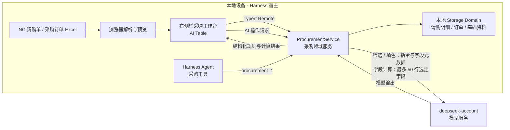
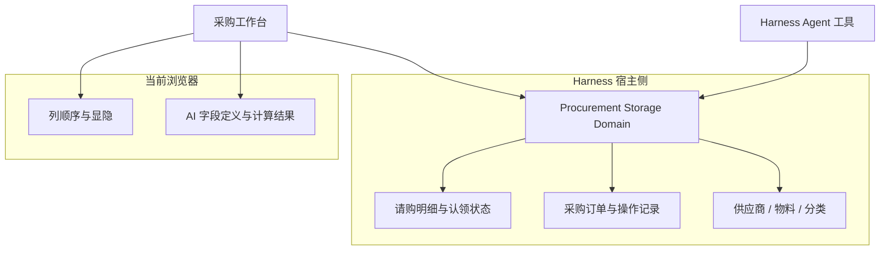

# 从多维表到 AI 采购工作台：一个 Harness 插件的产品设计

> 面向缺少专业 SRM 的物流团队，把采购工作流接入 DeepSeek Harness 的一次产品实践。

这款插件背后有三条现实约束，也决定了它从哪里切入。

笔者所在的物流企业数字化程度不高，目前没有专业 SRM 系统，采购团队多半用多维表管理业务数据。采购员常从一张 Excel 开始处理请购需求；导入后要筛选并认领明细，补上供应商和预计发货时间，再持续更新待办。订单导入后，也要核对请购与订单的关系并持续跟进。

插件面向采购员等业务人员，他们不是专业 IT 人员。因此，产品要沿用现成的 Excel 和表格工作习惯，尽量做到安装后即可开始操作。用户不必理解数据模型或编写代码，也无需配置复杂流程。我把工作台做成 DeepSeek Harness 的右侧栏插件，让用户在熟悉的工作环境里处理明细，并让 Agent 通过受限工具访问同一套采购服务。当前产品先接住采购员手头的工作，完整 SRM 的建设不在这个插件的范围内。“即插即用”是产品目标。

数据安全也是设计约束。插件没有部署自己的云端采购数据库，采购业务记录由本地 Harness 宿主管理。不过，“业务数据存本地”不等于“AI 处理完全留在本机”：当前 AI 功能使用 Harness 的 `deepseek-account` 模型服务，AI 字段计算会发送最多 50 行中被选中的字段值。这个边界会影响哪些数据适合交给模型处理，文章后面会进一步说明。

## 从请购明细组织工作

插件先处理采购员每天面对的两类文件：NC 请购单和采购订单。请购单可以在面板里导入，浏览器解析工作簿、识别常见表头，并提供工作表切换和预览。系统按请购单、物料等信息生成明细识别键；再次导入时会合并已有记录，并保留已认领状态和采购员填写的跟进信息。

明细进入工作台后分成两个视图。待筛选池用于查找和认领需求；“我的需求”用于继续补充供应商和预计发货日期，再填写下一步动作、等待对象与备注。认领会记录确认时间和批次。采购订单则单独导入、去重和管理；订单状态发生变化时，服务会尝试同步唯一关联的已认领需求。

这个流程让表格围绕工作状态组织起来：一行明细从待处理进入个人跟进，再与采购订单形成关联。采购员能在同一处查看明细归属和待办信息，也能继续完成具体操作。

## 把智能表格做成业务操作面

待筛选和我的需求都使用 AI Table。采购员可以查询和整理表格，也能调整列配置、创建分组视图，并为行或单元格填色。这个界面围绕明细组织查找、认领和持续跟进。

自然语言能力主要用于生成筛选规则、填色规则和逐行计算 AI 字段。采购员描述要筛出的需求或要标记的行后，模型会把指令转成结构化规则，再交由表格执行。筛选和排序由宿主端查询服务处理；填色作用于当前表格数据；AI 字段按行预览，每次最多计算 50 行。

模型负责把指令转成规则和结果，宿主负责校验 AI 返回的字段规则和结果格式，填色也必须在支持的范围内。无法通过校验的输出会报错，不会悄悄变成一条不受约束的业务规则。模型与推理强度可以在面板中设置并保存。

三类 AI 操作发送给模型的内容并不相同。筛选和填色会发送用户指令及可用字段信息；AI 字段计算还会发送参与计算的行数据，每次最多 50 行。对采购产品来说，本地存储解决的是业务记录如何落地，模型调用解决的是哪些数据会离开本机，两者需要分别评估。当前实现让采购数据库留在本地，但 AI 请求会经过 Harness 的模型服务；因此它适合要求业务系统和采购库不部署到云端、同时允许受控 AI 推理调用的场景。若企业要求任何采购字段都不能发送到外部模型，则现有 AI 字段功能不满足这一要求，需要改用本地模型，或先收紧 AI 功能可访问的数据范围。

## 面板和 Agent 共用采购服务

工作台作为 Harness 右侧栏扩展运行。浏览器面板通过 Typert Remote 调用宿主的 `ProcurementService`；Harness Agent 使用 `procurement_*` 工具进入同一个服务。两边读取和修改的是同一份宿主侧采购数据，业务规则也集中在采购领域服务里。

Agent 可以查询和搜索需求、认领明细、更新已认领需求的跟进字段，也能从工作区路径导入请购单。当前没有供 Agent 修改采购订单状态的工具；订单通知和取消由工作台的订单流程处理，关联状态再同步到请购明细。工具接口限定了 Agent 可执行的动作和参数；例如，`procurement_update_line` 只更新跟进字段。认领和跟进变更会留下操作记录。

产品上，这样做减少了两套入口各自维护业务规则的成本。采购员从面板操作，Agent 根据任务调用工具，最终都落在同一个服务和数据域里。Agent 的能力范围可以从工具注册表和领域规则中明确审视。

## 数据归属也是产品设计

请购明细和采购订单由本地 Harness 的 Storage Domain 管理，供应商及物料基础资料也存放在其中。表格列设置保存在浏览器的 `localStorage`；AI 字段定义和计算结果也留在当前浏览器。这些数据的生命周期不同：前者代表采购业务事实，后者代表工作视图。

当前还有一项限制。Agent 通过宿主服务访问业务数据，浏览器里的自定义 AI 字段结果则不会自动出现在 Agent 的数据视图里。若要让 Agent 使用这些结果，需要把字段定义和计算值同步到宿主存储。插件目前的持久化模型也按单机单采购员使用来设计；扩展到多人协作时，还需要补上组织、身份、数据权限和共享配置的设计。

## 我从这个项目里得到的产品判断

做 AI 工作台时，入口可以是聊天框，工作结果却要回到业务对象上。采购员需要定位请购明细，确认负责人和下一步待办，并继续追踪订单状态变化。把 AI 放在表格操作和 Agent 工具里，能让模型输出落到这些具体对象和既有业务规则上。

这也要求产品明确区分业务事实、个人视图设置和 Agent 可执行的动作。这个插件已经把业务数据和 Agent 工具放进同一宿主服务，也把 AI 输出限制为可校验的结构化结果。多人协作和 AI 字段跨端共享，则是继续演进时需要解决的产品问题。

---

### 校对用：实现依据

- `README.md`：功能范围、数据模型、远程方法、Agent 工具和持久化边界。
- `src/client/features/requisitions/table-views.cjs`：请购明细的 AI Table 字段与查询配置。
- `src/client/lib/ai-adapter.cjs`：筛选、填色和 AI 字段预览如何进入远程服务。
- `src/host/procurement-service.js`：Harness 工具注册、AI 输出校验和采购服务接口。
- `src/host/procurement-domain-service.js`：导入合并、认领、跟进、订单同步等领域逻辑。
- `src/host/schemas.js`：请购明细、订单和基础资料的数据结构。
- `remote-def.js`：Typert Remote 请求和方法定义。
